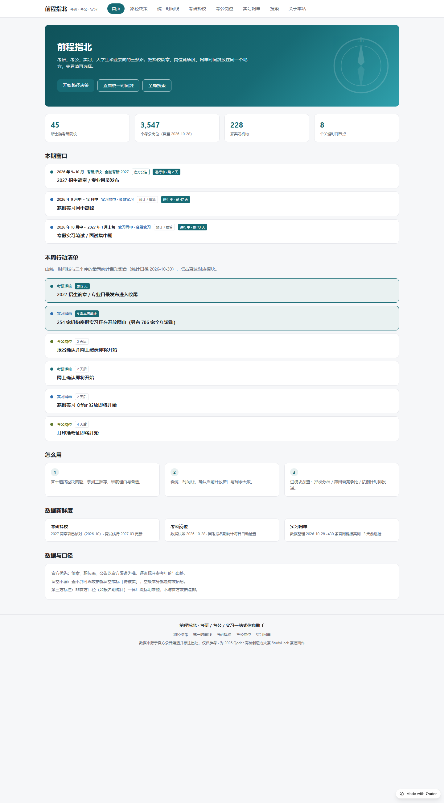

# 前程指北 · 考研考公实习一站式信息助手

**在线体验：https://sanchalu-w5xdi6xev4t.qoder.website**

为 2026 Qoder 高校创造力大赛（StudyHack 学习科研赛道）而作：给在考研、考公、实习之间做选择的大学生，把择校简章、岗位竞争度、网申时间线放进同一个网站，并用跨路径工具帮你看清「选哪条、什么时候动手、怎么落地」。



## 功能

- **路径决策**：十道题十个维度（毕业诉求 / 学术兴趣 / 应试基础 / 时间投入 / 风险偏好 / 经济因素 / 地域 / 年级窗口 / 已有资源 / 五年画像）打分，给出主推荐、维度理由、备选与近期节点；结果可经 `?a=` 链接分享，可一键生成三轨规划报告（打印/PDF）。
- **统一时间线**：36 条关键节点（考研 8 / 考公 22 / 实习 6），官方公告与预计推算分标，当前窗口高亮并显示剩余天数。
- **全局搜索**：构建期索引 17,819 条（211 院校 / 16,543 岗位 / 1,064 机构），简称表 + 子序列匹配（「北大」正确命中北京大学），结果直达模块并自动定位。
- **考研择校**：211 所院校的复试线、学费学制、初试科目、拟招与就业；预估分冲稳保分档、对比、CSV/报告导出。
- **考公岗位**：国考 / 浙江选调 / 浙江省考 / 山东省考 / 上海市考 16,543 个岗位的竞争比、进面分与报考档案分析。
- **实习网申**：1,064 家机构网申批次、倒计时、时间轴、投递进度看板与官网链接巡检。
- **三轨档案**：一次填写（届别 / 专业 / 预估分 / 地域 / 数学），三个模块自动预填。

## 架构

外壳（hash 路由）+ iframe 沙箱：三个业务模块以固定视口 iframe 嵌入，样式与全局变量天然隔离；外壳负责跨路径能力与统一视觉层（`hub/shared/hub-module.css`）。全站静态资源，无框架、无构建步骤、无账号体系，收藏与进度保存在本机浏览器（可导出/导入备份）。

```
hub/                 站点源码（Qoder Sites 部署目录）
  index.html shell.js shell.css
  shared/            tokens / 视觉统一层 / 时间线数据 / 搜索索引 / 首页统计
  modules/           kaoyan(renderer+data) / gongkao / intern
functions/           预留的云端收藏 Functions（待后端配额启用）
db/schema.sql        预留的收藏表结构
tools/serve-hub.js   本地开发服务器（node tools/serve-hub.js，端口 8123）
contest/             天池参赛帖与截图
```

## 本地运行

```bash
node tools/serve-hub.js   # http://127.0.0.1:8123
```

## 数据声明

考研数据整理自研招网与各校研究生院官网；考公数据整理自国家公务员局专题站与各省官方职位表；实习时间按往年网申规律推算并明确标注。官方优先、留空不编、第三方标注，全部仅供参考。

## 作者

浙江工商大学金融学专业。问题与建议：邮箱 3426493108@qq.com · 微信 Zaiayn。
