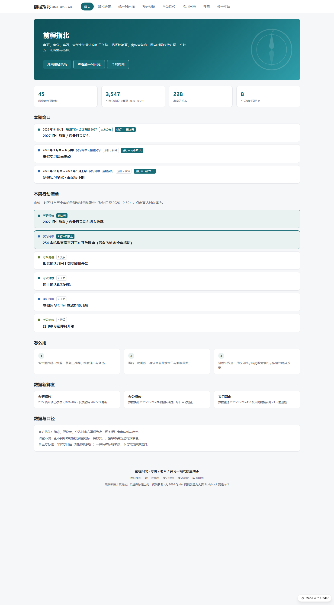

# 前程指北 · 考研考公实习一站式信息助手

**在线体验：https://sanchalu-w5xdi6xev4t.qoder.website**

为 2026 Qoder 高校创造力大赛（StudyHack 学习科研赛道）而作：给在考研、考公、实习之间做选择的大学生，把择校简章、岗位竞争度、网申时间线放进同一个网站，并用跨路径工具帮你看清「选哪条、什么时候动手、怎么落地」。



## 功能

- **路径决策**：十道题十个维度（毕业诉求 / 学术兴趣 / 应试基础 / 时间投入 / 风险偏好 / 经济因素 / 地域 / 年级窗口 / 已有资源 / 五年画像）打分，给出主推荐、维度理由、备选与近期节点；结果可经 `?a=` 链接分享，可一键生成三轨规划报告（打印/PDF）。
- **统一时间线**：40 条关键节点，官方公告与预计推算分标，当前窗口高亮并显示剩余天数。
- **全局搜索**：构建期索引 87,104 条（3,429 条院校专业记录 / 81,182 岗位 / 2,493 机构），简称表 + 子序列匹配（「北大」正确命中北京大学），结果直达模块并自动定位。
- **考研择校**：31 个专业大类、3,429 条院校专业记录。金融 211 所最完整（复试线/学费学制/拟招/就业）；其余大类院校名单取自研招网「专业知识库·专业点分布」官方页（按省完整名单）与公开招生单位汇总，专硕/学硕两侧分别标注专业代码与初试科目组合——计算机 193、理学 178、社会学/政治学/马克思 177、机械 154、工商管理 MBA 135、公共管理 MPA 125、教育 111、土木水利 101、软件工程 98、应用统计 99、国际商务 96、艺术 105、翻译 310、会计 MPAcc 300、新闻与传播 215、应用心理 121、法律非法学 108 等。预估分冲稳保分档、对比、CSV/报告导出；2026 国家线含单科。专业库由招生单位自主维护、非当年目录全量，已在每条 note 写明；未核实的复试线/学费/拟招一律留空。
- **考公岗位**：覆盖 18 类考试、81,182 个岗位（国考、浙江、山东、上海、江苏、广东、北京、福建、安徽、天津、重庆、湖南、湖北、江西、河南、河北逐岗；四川全量逐岗）；按勾选考试懒加载，首屏先出主文件、往届数据后台补载。竞争度：浙江2026 有官方逐岗报名人数，四川2027 全量 4,561 职并入官方最终「缴费人数/招录名额」比例区间，广东2027 并入报名期快照的两端区间（<5:1 / >200:1）；区间与精确竞争比分开展示、标注口径与截止时间，不混算。
- **实习网申**：2,493 家机构网申批次、倒计时、时间轴、投递进度看板与官网链接巡检；覆盖金融/经管、互联网科技、智能制造、传媒、律所、教育、医药、设计艺术、公共研究、农林食品、建筑土木、体育、旅游酒店，支持按学科一键筛选，并可在一个学科下继续选细分方向（显式标注：理工 842、经管 826、人文 580、法学 403、教育 350、艺术 335、社科 283、医药 161、农学 120、体育 116、建筑 111、旅游 108）。官网/网申链接 709 家（569 家标记「官网已实测」），核验要求 HTTP 200 且页面标题/正文命中机构名或英文别名——本轮据此剔除 65 家猜错的域名（含被抢注成赌博/色情站、域名停靠售卖、指向他司的情况）；其余机构多为无统一网申门户的小而美/培训/设计类，走第三方平台投递。巡检生成器 `tools/ci-check-links.js`。
- **三轨档案**：一次填写（届别 / 专业 / 预估分 / 地域 / 数学），三个模块自动预填。

## 架构

外壳（hash 路由）+ iframe 沙箱：三个业务模块以固定视口 iframe 嵌入，样式与全局变量天然隔离；外壳负责跨路径能力与统一视觉层（`hub/shared/hub-module.css`）。全站静态资源，无框架、无构建步骤、无账号体系，收藏与进度保存在本机浏览器（可导出/导入备份）。

```
hub/                 站点源码（Qoder Sites 部署目录）
  index.html shell.js shell.css
  shared/            tokens / 视觉统一层 / 时间线数据 / 搜索索引 / 首页统计
  modules/           kaoyan(renderer+data) / gongkao / intern
functions/           预留的云端收藏 Functions（待后端配额启用）
db/schema.sql        预留的收藏表结构
tools/serve-hub.js   本地开发服务器（node tools/serve-hub.js，端口 8123）
data-src/            考公逐岗 JSON 与搜索索引源文件（发布前 node tools/build-gzip.mjs 压到 hub/）
contest/             天池参赛帖与截图
```

## 本地运行

```bash
node tools/serve-hub.js   # http://127.0.0.1:8123
```

## 数据声明

考研数据整理自研招网与各校研究生院官网；考公数据整理自国家公务员局专题站与各省官方职位表；实习时间按往年网申规律推算并明确标注。官方优先、留空不编、第三方标注，全部仅供参考。

## 作者

浙江工商大学金融学专业。问题与建议：邮箱 3426493108@qq.com · 微信 Zaiayn。
